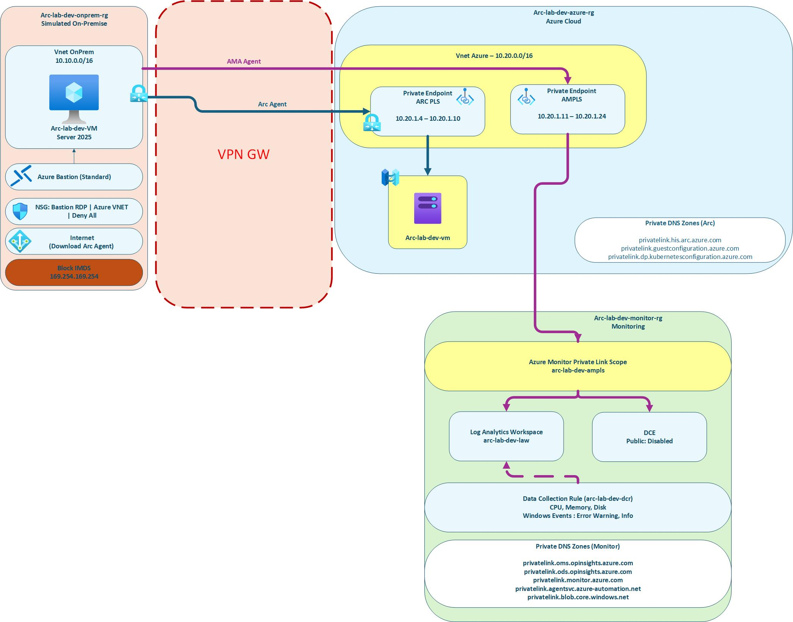

# Azure Arc + AMPLS Sandbox (Full Private Link)

This repository provides a complete sandbox environment to explore **Azure Arc** and **Azure Monitor Private Link Scope (AMPLS)** in a **private setup using Azure Private Link**.

Everything is deployed and configured **automatically via Terraform**: no manual scripts and no VM login required for onboarding.

> ℹ️ This project is inspired by the community work from [Azure Arc Jumpstart](https://github.com/microsoft/azure_arc).
> The Terraform code deploys a private environment integrating Azure Arc, AMPLS, and Private Link.

## 🎯 Purpose

The goal is to understand and test:

- Hybrid machine onboarding with **Azure Arc** via **Private Link**
- How **AMPLS** (Azure Monitor Private Link Scope) works in a private network
- DNS resolution via **Private DNS Zones**
- Automated monitoring with **Azure Monitor Agent (AMA)** and **Data Collection Rules (DCR)**



> ⚠️ This environment is intended for **testing and learning purposes only**. It **must not be used in production**.

## 📦 Architecture Overview

| Component | Description |
|-----------|-------------|
| **VNet OnPrem** (10.10.0.0/16) | Simulated on-premises network |
| **VNet Azure** (10.20.0.0/16) | Azure cloud network hosting the Private Endpoints |
| **VNet Peering** *or* **VPN Gateway** | OnPrem ↔ Azure connectivity (`enable_vpn_gateway`) |
| **NAT Gateway** | Outbound internet for the OnPrem subnet (agent downloads, Entra ID sign-in) |
| **Windows Server 2025** | Simulated on-prem VM with Arc agent + AMA |
| **Azure Bastion** | Secure management access (RDP) |
| **Arc Private Link Scope** | Private connectivity for Arc onboarding |
| **AMPLS** | Private connectivity for Azure Monitor (ingestion and query: `PrivateOnly`) |
| **Private DNS Zones** | Private name resolution for all endpoints |
| **Log Analytics Workspace** | Centralized log storage |
| **DCE / DCR** | Perf counters (CPU, Memory, Disk) + Windows Events (Error/Warning) |

### Traffic Flow
```
VM (10.10.1.x) → VNet Peering or VPN tunnel → Private Endpoints (10.20.1.x) → Arc PLS / AMPLS → Log Analytics
```

Arc and Azure Monitor traffic flows **only through Private Endpoints**. The NAT Gateway is only used for what has no private endpoint: downloading the Azure CLI and the Arc agent, and Entra ID authentication.

## 📁 Repository Structure
```
.
├── README.md
├── asset/                          # Architecture diagram
└── Terraform/
    ├── main.tf                     # Root module - orchestration
    ├── variables.tf                # Root variables (with validation)
    ├── outputs.tf                  # Root outputs
    ├── providers.tf                # azurerm, azapi, time, random
    ├── terraform.tfvars            # Non-secret configuration
    └── modules/
        ├── networking/             # VNets, Peering/VPN, NAT, NSG, Arc PLS + Private Endpoint, DNS Zones
        ├── compute/                # VM, Bastion, Arc onboarding (run command), AMA, DCR/DCE associations
        │   └── scripts/bootstrap-arc.ps1
        └── monitoring/             # Log Analytics, AMPLS + Private Endpoint, DCE, DCR, DNS Zones
```

## ✅ Prerequisites

- [Azure CLI](https://learn.microsoft.com/en-us/cli/azure/install-azure-cli)
- [Terraform](https://developer.hashicorp.com/terraform/downloads) **>= 1.13**
- Permission to create a Service Principal and assign roles on the subscription
- The Arc resource providers registered on the subscription. The provider is configured with `resource_provider_registrations = "none"`, so Terraform will not register them for you:
  ```powershell
  az provider register -n Microsoft.HybridCompute --wait
  az provider register -n Microsoft.HybridConnectivity --wait
  az provider register -n Microsoft.GuestConfiguration --wait
  az provider register -n Microsoft.Insights --wait
  az provider register -n Microsoft.OperationalInsights --wait
  ```

## 🔧 Setup

### 1. Clone the repository
```powershell
git clone https://github.com/technicalandcloud/Azure_Arc_PrivateLink_AMPLS.git
cd Azure_Arc_PrivateLink_AMPLS\Terraform
```

### 2. Create the Arc onboarding Service Principal

The VM uses this Service Principal to onboard itself to Azure Arc. It only needs **Azure Connected Machine Onboarding**, plus **Reader** so the bootstrap script can read the Arc Private Endpoint DNS configuration.

```powershell
az login
$subId = az account show --query id -o tsv

$sp = az ad sp create-for-rbac `
    --name "arc-lab-sp" `
    --role "Azure Connected Machine Onboarding" `
    --scopes "/subscriptions/$subId" -o json | ConvertFrom-Json

Start-Sleep -Seconds 30   # let the SP propagate before the next role assignment
az role assignment create --assignee $sp.appId --role Reader --scope "/subscriptions/$subId" -o none
```

> The secret (`$sp.password`) is displayed only once. If you lose it, create a new one without revoking the others:
> `az ad app credential reset --id <appId> --append --query password -o tsv`

### 3. Pass the credentials as environment variables

Keep secrets **out of `terraform.tfvars`** and pass them with `TF_VAR_*` environment variables:

```powershell
$env:TF_VAR_tenant_id         = az account show --query tenantId -o tsv
$env:TF_VAR_subscription_id   = $subId
$env:TF_VAR_arc_client_id     = $sp.appId
$env:TF_VAR_arc_client_secret = $sp.password
```

> ⚠️ Any value set in `terraform.tfvars` **overrides** the `TF_VAR_*` environment variables, even an empty string. Leave the credential lines commented out in `terraform.tfvars`.
> The variables are validated: the plan fails immediately with a clear message if one of them is empty.

Environment variables only live in the current PowerShell session. Run `plan`, `apply` and `destroy` from the same window.

### 4. Review the configuration

Non-secret settings are in `terraform.tfvars` (see [Configuration Options](#-configuration-options)).

## 🚀 Deployment

```powershell
terraform init
terraform plan -out tfplan
terraform apply tfplan
```

To use the VPN Gateway instead of VNet Peering:
```powershell
terraform plan -var enable_vpn_gateway=true -out tfplan
terraform apply tfplan
```

| Mode | Approx. duration |
|------|-----------------|
| VNet Peering (default) | ~20-25 min |
| VPN Gateway | ~60-70 min (each gateway takes ~30-45 min) |

Terraform will automatically:

1. ✅ Create 3 resource groups (onprem, azure, monitor)
2. ✅ Deploy the VNets with Peering or VPN Gateways, plus a NAT Gateway for outbound access
3. ✅ Configure the NSG, Private Endpoints and Private DNS Zones
4. ✅ Create the Log Analytics Workspace, AMPLS, DCE and DCR
5. ✅ Deploy a Windows Server 2025 VM with Azure Bastion
6. ✅ Run the bootstrap script on the VM (via VM Run Command):
   - Block IMDS and set `MSFT_ARC_TEST` so the Azure VM behaves like an on-prem server
   - Install the Azure CLI and configure the hosts file for Arc Private Link
   - Install the Arc Connected Machine Agent and onboard it through the Arc Private Link Scope
7. ✅ Install the Azure Monitor Agent (AMA) as an Arc extension
8. ✅ Associate the DCR and the DCE with the Arc machine

Data (Heartbeat, Perf) usually reaches Log Analytics **3 to 15 minutes** after the apply completes.

## 🔑 Retrieve VM Credentials

```powershell
terraform output -json vm_credentials
```

Output example:
```json
{
  "password": "aBcDeFgHiJkL1234",
  "username": "arcadmin"
}
```

Use these credentials to connect via **Azure Bastion** in the portal.

## ✔️ Post-Deployment Verification

### Via Azure CLI (from your workstation)

```powershell
# Arc machine: expect "Connected" and the Arc Private Link Scope ID
az resource show -g arc-lab-dev-azure-rg -n arc-lab-dev-vm `
  --resource-type Microsoft.HybridCompute/machines `
  --query "{status:properties.status, pls:properties.privateLinkScopeResourceId}"
```
```json
{
  "pls": "/subscriptions/<SUB_ID>/resourceGroups/arc-lab-dev-azure-rg/providers/Microsoft.HybridCompute/privateLinkScopes/arc-lab-dev-arc-pls",
  "status": "Connected"
}
```

```powershell
# AMA extension: expect "Succeeded"
az rest --method get `
  --url "https://management.azure.com/subscriptions/<SUB_ID>/resourceGroups/arc-lab-dev-azure-rg/providers/Microsoft.HybridCompute/machines/arc-lab-dev-vm/extensions?api-version=2024-07-10" `
  --query "value[].{name:name, state:properties.provisioningState}" -o table
```
```
Name                      State
------------------------  ---------
AzureMonitorWindowsAgent  Succeeded
```

```powershell
# AMPLS: expect PrivateOnly and an Approved private endpoint
az resource show -g arc-lab-dev-monitor-rg -n arc-lab-dev-ampls `
  --resource-type microsoft.insights/privateLinkScopes `
  --query "properties.{ingestion:accessModeSettings.ingestionAccessMode, query:accessModeSettings.queryAccessMode, pe:privateEndpointConnections[].properties.privateLinkServiceConnectionState.status}"
```
```json
{
  "ingestion": "PrivateOnly",
  "pe": [ "Approved" ],
  "query": "PrivateOnly"
}
```

```powershell
# VPN mode only: expect "Connected" on both connections
az network vpn-connection show -g arc-lab-dev-onprem-rg -n arc-lab-dev-onprem-to-azure --query connectionStatus -o tsv
az network vpn-connection show -g arc-lab-dev-azure-rg  -n arc-lab-dev-azure-to-onprem --query connectionStatus -o tsv
```
```
Connected
Connected
```

### Via Azure Bastion (on the VM)

```powershell
& "$env:ProgramW6432\AzureConnectedMachineAgent\azcmagent.exe" show
# Expected: Agent Status = Connected

& "$env:ProgramW6432\AzureConnectedMachineAgent\azcmagent.exe" check -p
# Expected: endpoints Reachable = true, Private = true

Resolve-DnsName "<WORKSPACE_ID>.ods.opinsights.azure.com"
Resolve-DnsName "<WORKSPACE_ID>.oms.opinsights.azure.com"
# Expected: private IPs (10.20.1.x)

Get-Content C:\Windows\Temp\ArcBootstrap.log   # bootstrap script log
```

### Via Azure Portal

- **Azure Arc > Servers** → VM status = `Connected`
- **Arc > VM > Extensions** → `AzureMonitorWindowsAgent` = `Succeeded`
- **Monitor > Private Link Scopes** → AMPLS with LAW and DCE linked
- **Monitor > Data Collection Rules** → DCR with the Arc machine associated
- **Private DNS Zones** → records resolving to private IPs

### Via Log Analytics (KQL queries)
```kql
// Data received per table
union Heartbeat, Perf, Event
| where TimeGenerated > ago(1h)
| summarize count(), lastSeen = max(TimeGenerated) by Type, Computer
// Expected (a few minutes after deployment):
// Type       Computer         count_  lastSeen
// Heartbeat  arc-lab-dev-vm   9       2026-11-16T09:12:37Z
// Perf       arc-lab-dev-vm   97      2026-11-16T09:12:37Z

// CPU usage
Perf
| where ObjectName == "Processor" and CounterName == "% Processor Time"
| where TimeGenerated > ago(30m)
| summarize AvgCPU = avg(CounterValue) by bin(TimeGenerated, 1m)
| render timechart

// Memory
Perf
| where ObjectName == "Memory" and CounterName == "Available MBytes"
| where TimeGenerated > ago(30m)
| summarize avg(CounterValue) by bin(TimeGenerated, 1m)
| render timechart

// Windows Events (Error and Warning only: may be empty on a fresh VM)
Event
| where TimeGenerated > ago(1h)
| summarize count() by EventLevelName, Source
```

> The AMPLS `queryAccessMode = PrivateOnly` only restricts clients on networks connected to the AMPLS. The workspace still accepts queries from the portal and from Azure services.

## 🔐 Proving Private Link

| Check | Expected Result |
|-------|----------------|
| `azcmagent check -p` | Endpoints `Private = true` |
| `Resolve-DnsName *.ods.opinsights.azure.com` | IP = `10.20.1.x` |
| `Resolve-DnsName *.oms.opinsights.azure.com` | IP = `10.20.1.x` |
| `Test-NetConnection *.ods.opinsights.azure.com -Port 443` | `RemoteAddress = 10.20.1.x`, `TcpTestSucceeded = True` |
| DCE in portal | `Public network access = Disabled` |
| AMPLS in portal | LAW + DCE linked, PE = `Approved`, access modes = `PrivateOnly` |
| IMDS request | Timeout (blocked by firewall rule) |

## 🧹 Cleanup

Always clean up with Terraform, using the **same `enable_vpn_gateway` value** as for the deployment:

```powershell
terraform destroy                              # peering mode
terraform destroy -var enable_vpn_gateway=true # VPN mode
```

- The Arc machine is created by `azcmagent`, not by Terraform, so it is not in the state. The provider is configured with `prevent_deletion_if_contains_resources = false` so that the resource group containing it can still be deleted.
- The Log Analytics workspace goes into **soft-delete for 14 days**. Redeploying with the same name automatically recovers it.
- The Service Principal is **not** deleted. Remove it when you no longer need it: `az ad sp delete --id <appId>`.

> If you delete the resource groups manually (portal or `az group delete`), the Terraform state no longer matches Azure. Move `terraform.tfstate*` out of the folder before redeploying.

## 🩺 Troubleshooting

| Error | Cause | Fix in this repo |
|-------|-------|------------------|
| `SkuNotAvailable` for the VM | The VM size has no capacity, or is not offered to your subscription in the region | Default is `Standard_D2as_v7`. Check available sizes: `az vm list-skus -l <region> --resource-type virtualMachines`. The Gen2 image and the disk controller (NVMe for v6/v7, SCSI otherwise) adapt to `vm_size` automatically |
| `NonAzSkusNotAllowedForVPNGateway` | Azure no longer accepts non-AZ VPN Gateway SKUs (`VpnGw1`-`5`) | Gateways use `VpnGw1AZ` with zone-redundant public IPs |
| `InvalidPayload: Data collection rule is invalid` | The workspace was just recovered from soft-delete and is not yet a valid DCR destination | A 90-second wait is applied between the workspace and the DCR. If it still happens, run `apply` again |
| `InvalidDataFlow: Duplicate data flows for a stream` when editing the DCR in the portal | The portal DCR wizard expects one data flow per stream; a single flow with several streams shows as "Unknown data source" | The DCR uses one data flow per stream (`Microsoft-Perf`, `Microsoft-Event`). Note that portal edits (e.g. custom XPath queries) are overwritten by the next `terraform apply` |
| `parsing "/subscriptions//resourceGroups/..."` | A credential is empty, usually because `terraform.tfvars` overrides `TF_VAR_*` | Comment out the credential lines in `terraform.tfvars` |
| Arc onboarding fails | Check `C:\Windows\Temp\ArcBootstrap.log` on the VM (via Bastion) | In VPN mode, both connections must be `Connected` before the VM is created (Terraform waits for the networking module) |

## 📝 Configuration Options

| Variable | Default | Description |
|----------|---------|-------------|
| `project_name` | `arc-lab` | Project name prefix |
| `environment` | `dev` | Environment (dev, staging, prod) |
| `location` | `francecentral` | Azure region |
| `vm_size` | `Standard_D2as_v7` | VM size (Gen2 image; disk controller picked automatically) |
| `vm_admin_username` | `arcadmin` | VM admin username |
| `vm_admin_password` | `""` (auto) | VM password (empty = auto-generated) |
| `enable_vpn_gateway` | `false` | `true` = two `VpnGw1AZ` gateways (Vnet2Vnet) instead of VNet Peering |
| `enable_ampls` | `true` | Deploy AMPLS + monitoring stack |
| `log_retention_days` | `30` | Log retention in days |
| `tenant_id`, `subscription_id`, `arc_client_id`, `arc_client_secret` | (required) | Pass them as `TF_VAR_*` environment variables |

## 💶 Cost

The lab runs continuously while deployed (Bastion Standard, NAT Gateway, VM, Private Endpoints). VPN mode adds two `VpnGw1AZ` gateways. **Destroy the lab when you are not using it.**

## 📄 License

This project is for educational purposes. See [LICENSE](LICENSE) for details.
